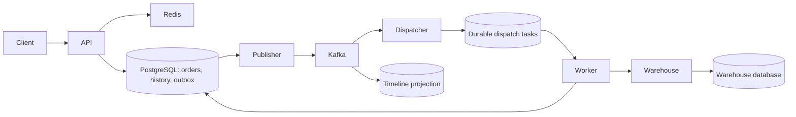

# Fulfillment Ledger

A Java 21 distributed order-fulfillment demo. The warehouse can accept a shipment and then hold the HTTP response past the caller's timeout. The platform records the uncertain result, queries the warehouse by fulfillment ID and converges on one shipment. PostgreSQL stores the business history. Kafka powers a separately replayable timeline.

## Run the lost-response demo

Prerequisites are Docker Compose with Linux containers and Python 3.9+. The application and its infrastructure run locally. Demo endpoints bind to loopback.

```sh
docker compose up --build -d
python scripts/smoke.py
```

The script activates a slow response for warehouse A, submits the same order twice, waits for the timeline below and verifies the durable warehouse record. It restores normal latency on exit.

```text
ACCEPTED → UNCONFIRMED → CONFIRMED
```

## Architecture



One Maven artifact runs under three profiles. API, worker and warehouse have separate processes. The worker hosts the publisher, two independent Kafka consumer groups, and per-warehouse dispatch lanes. The warehouse owns a separate PostgreSQL database. The API accepts a demo tenant header; production authentication belongs at the trust boundary before it.

| Technology | Responsibility |
|---|---|
| Spring Boot 4.1, Spring MVC, RestClient | Order and warehouse HTTP APIs with bounded network timeouts |
| Spring Data JPA, Hibernate, PostgreSQL, Flyway | Entities, optimistic versioning, transactional state/history, native PostgreSQL upserts and task claims, schema migrations |
| Spring Kafka, Apache Kafka | Keyed fulfillment events and independent dispatch/timeline offsets |
| Spring Data Redis, Lettuce | Shared cache for warehouse directory reads, jittered TTL and bounded database fallback |
| Actuator, Micrometer, OpenTelemetry | HTTP observations, Kafka instrumentation, workload metrics and OTLP tracing |
| SLF4J, Logback, Alloy, Loki, Tempo, Prometheus, Grafana | Structured logs, trace storage, metrics, alert rule and a provisioned dashboard |
| JUnit, Mockito, Testcontainers, WireMock, Toxiproxy, k6 | Rule tests, integration checks, failure injection and fixed-arrival-rate load |
| Maven, Docker Compose, GitHub Actions | Build, local deployment and verification on pushes and pull requests |

## Failure semantics

* **Client retries.** A unique tenant/key pair resolves to the original order. Reusing a key with different SKU, quantity or warehouse returns HTTP 409.
* **Publisher restart.** Order, history and outbox insert commit together. The publisher waits for Kafka acknowledgement before marking work complete. A crash in between may publish twice.
* **Consumer replay.** Dispatch inserts one durable task per order. Timeline rows use event IDs and business sequence numbers. A fresh timeline consumer group can replay retained events without invoking the warehouse.
* **Worker recovery.** Short transactions claim work using `FOR UPDATE SKIP LOCKED`. Leases use database time and a monotonically increasing claim token. Stale workers cannot overwrite a newer owner's progress. Network calls take place outside database transactions.
* **Ambiguous warehouse result.** Subsequent attempts query the stable shipment ID before resubmission. The simulator enforces a primary key on that ID and verifies payload equality. This recovery depends on the external warehouse offering compatible lookup and idempotency semantics.
* **Isolation.** A and B have separate scheduling lanes in the demo. Resolve uncertain shipments with capped exponential backoff. An operator can find overdue orders from the oldest-pending alert.

## HTTP examples

```sh
curl -i -X POST http://localhost:8080/orders -H 'Content-Type: application/json' \
  -H 'X-Tenant: demo' -H 'Idempotency-Key: example-1' \
  -d '{"warehouse":"A","sku":"BOOK-42","quantity":2}'
curl -H 'X-Tenant: demo' http://localhost:8080/orders/ORDER_UUID
curl -H 'X-Tenant: demo' http://localhost:8080/orders/ORDER_UUID/timeline
curl http://localhost:8080/warehouses/A
```

## Observe a failure

```sh
docker compose --profile observe up -d
```

Open Grafana at http://localhost:3000. The **Order fulfillment** dashboard shows pending age, warehouse outcomes, API latency and database pool pressure. The Prometheus rule fires when the oldest outstanding order exceeds five minutes for 30 seconds. Configure notification routing in your deployment.

In Grafana Explore select Loki, set the time range to the demo and search:

```logql
{service_name="worker"} | json | fulfillment_id="ORDER_UUID"
```

Look for `warehouse.result.unknown` followed by `warehouse.confirmed`. Use the trace link on sampled log entries to inspect a single execution in Tempo. Use the fulfillment ID across durable queues and later attempts, which can start new traces. The dashboard and logs contain no customer address or payment payload.

## Tests and capacity experiments

```sh
mvn test
mvn verify
k6 run -e RUN_ID=baseline-001 -e RATE=5 -e DURATION=30s load/orders.js
python scripts/reconcile.py baseline-001
```

Use a fresh run ID for each load run. Each iteration creates an order, reads warehouse metadata and queries the order.

### Measured throughput

On November 7, 2026, a 120-second single-host Linux test averaged **2,052 accepted orders/s** and **1,809 warehouse confirmations/s** end to end. The sustained fulfillment target of 2,000/s remains open. A preceding 30-second tuning run confirmed 2,097/s before per-order confirmation logging was restored.

The longer run included per-order confirmation logging, one API, one worker, a separate warehouse process, PostgreSQL, Kafka and Redis. The processes and load generator shared a memory-limited WSL environment. After warm-up, k6 scheduled 2,100 iterations/s with 400 virtual users. All 246,335 submitted orders succeeded; k6 dropped 5,666 scheduled iterations. Order creation P99 was 232 ms.

The first post-load snapshot counted 41,993 orders awaiting confirmation. The last confirmation arrived 16.20 seconds after the last admission. All 246,335 orders subsequently matched their warehouse payloads and confirmed timeline entries. The end-to-end rate includes this drain time. In 83 of the 120 one-second buckets, fewer than 2,000 orders reached confirmation.

[k6 measurements](benchmarks/2026-11-07/k6.json) · [Post-load snapshot](benchmarks/2026-11-07/results.txt) · [Reconciliation](benchmarks/2026-11-07/reconciliation.txt) · [Ten-second windows](benchmarks/2026-11-07/windows.txt)

`mvn verify` runs PostgreSQL, Kafka and Redis with Testcontainers and a WireMock warehouse. GitHub Actions also starts Compose and runs the persisted lost-response drill. For network experiments, start `docker compose --profile fault up -d`, configure a Toxiproxy listener with upstream `warehouse:8080`, and point the worker's `WAREHOUSE_URL` at that listener using a Compose override.

## Deployment boundaries

The Compose stack models a single host and one Kafka broker. Three-zone PostgreSQL synchronous replication, archived WAL with point-in-time restore, broker replication and disaster recovery drills require a multi-host deployment. The local credentials, anonymous Grafana viewer and demo slow-response endpoint are intended for loopback use. Broker retention limits historical replay; authoritative state transitions remain in PostgreSQL.

To stop the stack while retaining the database and Kafka volumes, run `docker compose --profile observe --profile fault down`.
