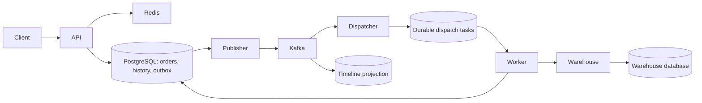

# Fulfillment Ledger

A Java 21 distributed order-fulfillment demo. The warehouse can accept a shipment and then hold the HTTP response past the caller's timeout. The platform records the uncertain result, queries the warehouse by fulfillment ID and converges on one shipment. PostgreSQL stores the business history. Kafka powers a separately replayable timeline.

## Run the lost-response demo

第一次调用项目，可直接看 [API reference（中文）](#api-reference)，里面有 PowerShell 下单示例和全部业务接口。

Prerequisites are Docker Compose with Linux containers and Python 3.9+. The application and its infrastructure run locally. Demo endpoints bind to loopback.

```sh
docker compose up --build -d
python scripts/smoke.py
```

The script activates a slow response for warehouse A, submits the same order twice, waits for the timeline below and verifies the durable warehouse record. It restores normal latency on exit.

```text
ACCEPTED → UNCONFIRMED → CONFIRMED
```

## Architecture



One Maven artifact runs under three profiles. API, worker and warehouse have separate processes. The worker hosts the publisher, two independent Kafka consumer groups, and per-warehouse dispatch lanes. The warehouse owns a separate PostgreSQL database. The API accepts a demo tenant header; production authentication belongs at the trust boundary before it.

| Technology | Responsibility |
|---|---|
| Spring Boot 4.1, Spring MVC, RestClient | Order and warehouse HTTP APIs with bounded network timeouts |
| Spring Data JPA, Hibernate, PostgreSQL, Flyway | Entities, optimistic versioning, transactional state/history, native PostgreSQL upserts and task claims, schema migrations |
| Spring Kafka, Apache Kafka | Keyed fulfillment events and independent dispatch/timeline offsets |
| Spring Data Redis, Lettuce | Shared cache for warehouse directory reads, jittered TTL and bounded database fallback |
| Actuator, Micrometer, OpenTelemetry | HTTP observations, Kafka instrumentation, workload metrics and OTLP tracing |
| SLF4J, Logback, Alloy, Loki, Tempo, Prometheus, Grafana | Structured logs, trace storage, metrics, alert rule and a provisioned dashboard |
| JUnit, Mockito, Testcontainers, WireMock, Toxiproxy, k6 | Rule tests, integration checks, failure injection and fixed-arrival-rate load |
| Maven, Docker Compose, GitHub Actions | Build, local deployment and verification on pushes and pull requests |

## Failure semantics

* **Client retries.** A unique tenant/key pair resolves to the original order. Reusing a key with different SKU, quantity or warehouse returns HTTP 409.
* **Publisher restart.** Order, history and outbox insert commit together. The publisher waits for Kafka acknowledgement before marking work complete. A crash in between may publish twice.
* **Consumer replay.** Dispatch inserts one durable task per order. Timeline rows use event IDs and business sequence numbers. A fresh timeline consumer group can replay retained events without invoking the warehouse.
* **Worker recovery.** Short transactions claim work using `FOR UPDATE SKIP LOCKED`. Leases use database time and a monotonically increasing claim token. Stale workers cannot overwrite a newer owner's progress. Network calls take place outside database transactions.
* **Ambiguous warehouse result.** Subsequent attempts query the stable shipment ID before resubmission. The simulator enforces a primary key on that ID and verifies payload equality. This recovery depends on the external warehouse offering compatible lookup and idempotency semantics.
* **Isolation.** A and B have separate scheduling lanes in the demo. Resolve uncertain shipments with capped exponential backoff. An operator can find overdue orders from the oldest-pending alert.

## API reference

### 启动服务

在装有 Git 和 Docker Compose 的终端运行以下命令。Docker Desktop 使用 Linux 容器。首次启动会构建 Java 应用并初始化数据库。

```sh
git clone https://github.com/nz284/fulfillment-ledger.git
cd fulfillment-ledger
docker compose up --build -d
docker compose ps
```

| 服务 | 本机地址 | 调用方和用途 |
|---|---|---|
| 订单 API | `http://localhost:8080` | 客户端创建订单、查看状态和时间线、查询仓库资料。 |
| 模拟仓库 | `http://localhost:8082` | Worker 自动提交和查询发货单。开发者也可以直接调用，验证幂等和超时恢复。 |
| Worker | Compose 内部 `http://worker:8080` | 自动消费 Kafka 消息、发货和重试。主机未映射该端口。 |

访问 `http://localhost:8080/actuator/health/readiness`，等到返回 `{"status":"UP"}` 再下单。一次正常调用从 **`POST /orders`** 开始；客户端拿到返回的 `id` 后，就能跟踪整笔订单。

### 在 PowerShell 中下第一单

以下示例可以在同一个 PowerShell 窗口依次运行。每笔新订单生成一个新键；重试同一笔订单时，沿用原来的 `$headers` 和 `$body`。

```powershell
$api = 'http://localhost:8080'
$warehouse = 'http://localhost:8082'
$headers = @{ 'X-Tenant' = 'demo'; 'Idempotency-Key' = [guid]::NewGuid().ToString() }
$body = @{ warehouse = 'A'; sku = 'BOOK-42'; quantity = 2 } | ConvertTo-Json

$order = Invoke-RestMethod -Method Post -Uri "$api/orders" -Headers $headers -ContentType 'application/json' -Body $body
$order
$id = $order.id

Invoke-RestMethod "$api/orders/$id" -Headers $headers
Invoke-RestMethod "$api/orders/$id/timeline" -Headers $headers
```

首次成功创建返回 **HTTP 202 Accepted**，响应示例如下。此时订单已经持久化，仓库确认在后台完成。

```json
{"id":"019a0000-0000-7000-8000-000000000001","warehouse":"A","sku":"BOOK-42","quantity":2,"state":"ACCEPTED"}
```

稍后再次执行最后两条查询。订单变为 `CONFIRMED` 后，运行 `Invoke-RestMethod "$warehouse/shipments/$id"` 可核对仓库收到的 SKU 和数量。时间线由 Kafka 异步生成，因此可能短暂返回 `[]` 或晚于订单状态更新。

### 订单 API · 端口 8080

发送 JSON 请求体时使用 `Content-Type: application/json`。`X-Tenant` 是演示用租户标识；服务按它隔离订单查询。创建订单时，租户标识为 1–100 个字符，幂等键为 1–160 个字符，两者均须包含非空白字符。

| 方法和路径 | 请求 | 成功响应 | 常见错误 |
|---|---|---|---|
| `POST /orders` | 必填头 `X-Tenant`、`Idempotency-Key`。JSON 字段 `warehouse` 为 `A` 或 `B`，`sku` 为最多 120 个字符的非空白字符串，`quantity` 为正整数。 | `202`，返回上例的五个字段。同租户、同键、同内容重试返回原订单 ID 和当前状态。 | `400` 缺头或字段无效；`409` 同键用于不同内容；`503` 受理队列暂不可用，可用原键重试。 |
| `GET /orders/{id}` | 路径参数为订单 UUID；必填头 `X-Tenant`。 | `200`，返回 `id`、`warehouse`、`sku`、`quantity`、`state`。 | `400` 缺头或 UUID 格式错误；`404` 订单不存在或属于其他租户。 |
| `GET /orders/{id}/timeline` | 同上。 | `200`，按业务顺序返回状态字符串数组，例如 `["ACCEPTED","CONFIRMED"]`。 | 与订单详情相同。 |
| `GET /warehouses/{id}` | `id` 为 `A` 或 `B`，无需租户头。 | `200`，例如 `{"id":"A","name":"East warehouse"}`。 | `404` 仓库未知；`503` 缓存回源并发已满。 |

状态含义：`ACCEPTED` 表示平台已受理；`UNCONFIRMED` 表示仓库调用结果暂时未知，Worker 会按原单号查证；`CONFIRMED` 表示平台已确认仓库接单。一次正常履约可以从 `ACCEPTED` 直接到 `CONFIRMED`。

### 模拟仓库 API · 端口 8082

这些接口无需租户头。发货单使用订单的 `id` 作为 UUID，单笔和批量共用同一个发货单结构：

```json
{"id":"019a0000-0000-7000-8000-000000000001","warehouse":"A","sku":"BOOK-42","quantity":2}
```

| 方法和路径 | 请求 | 成功响应与行为 | 常见错误 |
|---|---|---|---|
| `POST /shipments` | 请求体是一个发货单对象。 | `200`，空响应体。重复提交相同 ID、仓库、SKU 和数量仍然成功。 | `409` 同一 ID 已记录不同内容。 |
| `POST /shipments/batch` | 请求体是 1–256 个发货单组成的 JSON 数组，每项使用不同 UUID。 | `200`，空响应体，整批在同一事务中提交。 | `400` 数组为空或超过 256 项；`409` 已有 ID 的内容冲突，整批回滚。 |
| `GET /shipments/{id}` | 路径参数为发货单 UUID。 | `200`，返回上例的四个字段。 | `400` UUID 格式错误；`404` 仓库查不到该单。 |
| `PUT /demo/slow/{warehouse}` | 使用 `A` 或 `B`；无需请求体。 | `200`，空响应体。该仓库先提交发货单，再延迟 3.5 秒响应；Worker 的读取超时为 2 秒。批量请求中有一项命中即可触发。 | 开关作用于当前模拟仓库进程，持续到关闭或进程重启。 |
| `DELETE /demo/slow/{warehouse}` | 使用与开启时相同的仓库编号；无需请求体。 | `200`，空响应体，恢复正常响应速度。 | 可重复关闭。 |

例如，在上面 PowerShell 会话中，以下命令用同一笔已确认的订单验证两种提交方式的幂等性：

```powershell
$shipment = Invoke-RestMethod "$warehouse/shipments/$id"
$one = ConvertTo-Json -InputObject $shipment -Compress
$batch = ConvertTo-Json -InputObject @($shipment) -Compress
Invoke-RestMethod -Method Post "$warehouse/shipments" -ContentType 'application/json' -Body $one
Invoke-RestMethod -Method Post "$warehouse/shipments/batch" -ContentType 'application/json' -Body $batch
```

要演示超时，运行 `Invoke-RestMethod -Method Put "$warehouse/demo/slow/A"`，用新幂等键向 A 仓下单，观察时间线，最后运行 `Invoke-RestMethod -Method Delete "$warehouse/demo/slow/A"`。仓库端按单号去重，平台按单号查证。也可以运行 `python scripts/smoke.py` 自动完成演练和清理。

### 健康检查和指标

三个 Java 进程均提供以下 `GET` 路径。本机可通过 8080、8082 访问对应进程，监控组件通过 Compose 网络访问 Worker。无需业务请求头。

| 路径 | 用途和返回内容 |
|---|---|
| `/actuator` | 已暴露管理端点的链接目录，返回 JSON。 |
| `/actuator/health` | 综合健康状态，返回 JSON。 |
| `/actuator/health/liveness` | 进程存活探针，例如 `{"status":"UP"}`。 |
| `/actuator/health/readiness` | 应用就绪探针。要验证完整履约链路，可运行上面的端到端演练。 |
| `/actuator/prometheus` | Prometheus 文本指标，可直接查看，例如 `curl http://localhost:8080/actuator/prometheus`。 |

## Observe a failure

```sh
docker compose --profile observe up -d
```

Open Grafana at http://localhost:3000. The **Order fulfillment** dashboard shows pending age, warehouse outcomes, API latency and database pool pressure. The Prometheus rule fires when the oldest outstanding order exceeds five minutes for 30 seconds. Configure notification routing in your deployment.

In Grafana Explore select Loki, set the time range to the demo and search:

```logql
{service_name="worker"} | json | fulfillment_id="ORDER_UUID"
```

Look for `warehouse.result.unknown` followed by `warehouse.confirmed`. Use the trace link on sampled log entries to inspect a single execution in Tempo. Use the fulfillment ID across durable queues and later attempts, which can start new traces. The dashboard and logs contain no customer address or payment payload.

## Tests and capacity experiments

```sh
mvn test
mvn verify
k6 run -e RUN_ID=baseline-001 -e RATE=5 -e DURATION=30s load/orders.js
python scripts/reconcile.py baseline-001
```

Use a fresh run ID for each load run. Each iteration creates an order, reads warehouse metadata and queries the order.

### Measured throughput

**120 consecutive seconds above 2,000 warehouse confirmations/s.** In the steady-state test, the lowest second contained **2,174** confirmations. All 288,002 measured orders matched warehouse records and the Kafka timeline. Throughput from the first admission through the last confirmation was **2,398.60 orders/s**. Warehouse confirmation P99 was **167 ms**; order creation P99 was **47 ms**.

The test offered 2,400 orders/s for 180 seconds with 512 k6 virtual users. The first 60 seconds used a separate tenant for warm-up. The following 120 seconds used the measurement tenant, without restarting k6 or its connections. The full run dropped 4,138 scheduled iterations and therefore failed its overall zero-drop threshold. The measurement tenant recorded 864,006 HTTP responses with zero errors. The final warehouse confirmation arrived 76 ms after the final admission. [Every measured second](benchmarks/2026-11-07/steady-2400/seconds.txt) · [Warehouse and timeline reconciliation](benchmarks/2026-11-07/steady-2400/reconciliation.txt) · [k6 summary](benchmarks/2026-11-07/steady-2400/results.txt)

For reproduction, first confirm a preflight order is visible in the warehouse and timeline. On a warmed single-host Linux stack, run the following with a fresh run ID:

```sh
k6 run -e RUN_ID=steady-001 -e RATE=2400 -e DURATION=180s -e WARM_SECONDS=60 \
  -e VUS=512 -e MAX_VUS=512 --summary-export=steady-001.json load/orders.js
python scripts/reconcile.py steady-001
docker compose exec -T postgres psql -U fulfillment -d fulfillment \
  -v tenant=steady-001 -v seconds=120 < scripts/capacity-report.sql
```

The Linux test ran the API, worker, simulated warehouse, PostgreSQL 17, Kafka, Redis and load generator on one machine. The workload's memory cgroup used a 3.125 GiB high watermark and a roughly 3.71 GiB maximum. PostgreSQL used 256 MiB of shared buffers, LZ4 full-page WAL compression, synchronous commits and fsync. Per-order confirmation logging was enabled. Results measure this steady-state workload; startup behavior is visible in the additional trials below.

| Other 120-second trials | Mean confirmations/s, including drain | Scheduled iterations dropped |
|---|---:|---:|
| [2,450 offered/s, 800 VUs](benchmarks/2026-11-07/ordered-2450) | 2,417.13 | 3,725 |
| [2,400 offered/s, 320 VUs](benchmarks/2026-11-07/ordered-2400) | 2,364.84 | 4,018 |
| [2,350 offered/s, 512 VUs, WAL compression](benchmarks/2026-11-07/compressed-2350) | 2,318.81 | 3,589 |

The optimized single-host Linux run reached **2,097.59 warehouse confirmations/s over 120 seconds**, including the final drain. It accepted 251,891 orders and matched every one to its warehouse payload and Kafka timeline. End-to-end P99 was 143 ms and the drain was 88 ms. All twelve ten-second windows exceeded 2,000 confirmations/s; four individual seconds fell below 2,000. k6 dropped 110 scheduled iterations. [Optimized run evidence](benchmarks/2026-11-07/ordered-2100)

The optimized worker removes acknowledged outbox rows while retaining business history and replay protection. PostgreSQL assigns time-ordered UUIDv7 IDs to new orders and normal-path events; existing UUIDs remain valid. The ready-queue index matches the lease query's ordering. Measurement begins after all warm-up orders reach both warehouse confirmation and the Kafka timeline.

**Earlier baseline.** On November 7, 2026, a 120-second single-host Linux test averaged 2,052 accepted orders/s and 1,809 warehouse confirmations/s end to end.

The longer run included per-order confirmation logging, one API, one worker, a separate warehouse process, PostgreSQL, Kafka and Redis. The processes and load generator shared a memory-limited WSL environment. After warm-up, k6 scheduled 2,100 iterations/s with 400 virtual users. All 246,335 submitted orders succeeded; k6 dropped 5,666 scheduled iterations. Order creation P99 was 232 ms.

The first post-load snapshot counted 41,993 orders awaiting confirmation. The last confirmation arrived 16.20 seconds after the last admission. All 246,335 orders subsequently matched their warehouse payloads and confirmed timeline entries. The end-to-end rate includes this drain time. In 83 of the 120 one-second buckets, fewer than 2,000 orders reached confirmation.

[k6 measurements](benchmarks/2026-11-07/k6.json) · [Post-load snapshot](benchmarks/2026-11-07/results.txt) · [Reconciliation](benchmarks/2026-11-07/reconciliation.txt) · [Ten-second windows](benchmarks/2026-11-07/windows.txt)

`mvn verify` runs PostgreSQL, Kafka and Redis with Testcontainers and a WireMock warehouse. GitHub Actions also starts Compose and runs the persisted lost-response drill. For network experiments, start `docker compose --profile fault up -d`, configure a Toxiproxy listener with upstream `warehouse:8080`, and point the worker's `WAREHOUSE_URL` at that listener using a Compose override.

## Deployment boundaries

The Compose stack models a single host and one Kafka broker. Three-zone PostgreSQL synchronous replication, archived WAL with point-in-time restore, broker replication and disaster recovery drills require a multi-host deployment. The local credentials, anonymous Grafana viewer and demo slow-response endpoint are intended for loopback use. Broker retention limits historical replay; authoritative state transitions remain in PostgreSQL.

To stop the stack while retaining the database and Kafka volumes, run `docker compose --profile observe --profile fault down`.
