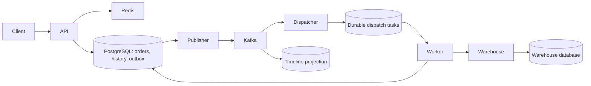

# Fulfillment Ledger

A Java 21 distributed order-fulfillment demo. The warehouse can accept a shipment and then hold the HTTP response past the caller's timeout. The platform records the uncertain result, queries the warehouse by fulfillment ID and converges on one shipment. PostgreSQL stores the business history. Kafka powers a separately replayable timeline.

## Run the lost-response demo

To place your first order, follow the PowerShell walkthrough in the [API reference](#api-reference).

Prerequisites are Docker Compose with Linux containers and Python 3.9+. The application and its infrastructure run locally. Demo endpoints bind to loopback.

```sh
docker compose up --build -d
python scripts/smoke.py
```

The script activates a slow response for warehouse A, submits the same order twice, waits for the timeline below and verifies the durable warehouse record. It restores normal latency on exit.

```text
ACCEPTED → UNCONFIRMED → CONFIRMED
```

## Two-worker crash and takeover drill

Run `python scripts/takeover.py` from the repository root with Python 3.9+ and Docker Compose 2.24.4+. The drill starts a disposable stack with two workers, private data volumes and dynamically assigned loopback ports. It removes that stack on exit. The regular demo can run independently.

1. Both workers join Kafka. The script submits an order to warehouse A and uses a test-only PostgreSQL advisory lock to hold the first worker inside its confirmation transaction.
2. The script reads the committed shipment from warehouse A, verifies that the order API still reports `ACCEPTED`, identifies the blocked worker from its database connection, and sends that container `SIGKILL`.
3. While the worker is down, the script submits an order to warehouse B. After A's original lease expires, the surviving worker looks up the existing shipment and confirms the order.
4. The drill checks both order timelines, two lease attempts for A, one committed warehouse submission, one matching shipment row, and one confirmation. It prints the remaining lease time at the crash, crash-to-confirmation time and B's admission-to-confirmation latency. The report also records whether B finished before A recovered.

The crash timer starts immediately before sending the kill command. Durations use PostgreSQL timestamps. Set `TAKEOVER_REPORT` to a file path to save the JSON result. The GitHub Actions verification workflow publishes this file as the **takeover-report** artifact.

The drill also submits a B order every 500 ms, starting at least 12 seconds before the crash and continuing through the following 50 seconds. Each trial reports sample counts, nearest-rank P95 and maximum latency separately for orders admitted before and after the kill boundary. Each B probe must reach warehouse confirmation, match its stored payload and appear in the Kafka timeline. CI runs two trials with fresh stacks.

In the JSON report, `b_trace.orders` contains the per-order timestamps (epoch seconds) and Kafka partition. Admission and confirmation use the database history/order transaction times. A drill-only database trigger timestamps task insertion and first claim. Worker debug logs timestamp the producer acknowledgement callback and the dispatch listener's receipt of the event; these observations use the same runner clock. Closely spaced acknowledgement and receipt observations can arrive in either order. `b_trace.rebalances` records partition assignment, revocation and loss messages by worker. A killed process cannot log its own revocation.

In the first verified run, A was confirmed 28.863 seconds after the crash. Its original lease had 28.705 seconds remaining when the kill command began. The warehouse recorded one submission and one shipment. B, submitted after the crash, took 45.411 seconds to confirm and finished after A. These are single-order measurements from this run. [CI run and report](https://github.com/nz284/fulfillment-ledger/actions/runs/42436180750)

### Warehouse B recovery latency

Each trial used the same B traffic pattern and killed one of two workers. Times below run from order admission to warehouse confirmation. Each baseline or tuned trial included 26 pre-crash and 100 post-crash probes.

| Kafka session timeout | Trial | Pre-crash P95 | Pre-crash max | Post-crash P95 | Post-crash max |
|---|---:|---:|---:|---:|---:|
| 45 s | 1 | 79 ms | 340 ms | 42.09 s | 45.09 s |
| 45 s | 2 | 176 ms | 259 ms | 30.11 s | 43.11 s |
| 9 s | 1 | 81 ms | 205 ms | 2.58 s | 9.08 s |
| 9 s | 2 | 113 ms | 265 ms | 1.10 s | 8.60 s |

The slowest baseline orders landed on partitions owned by the killed worker. The survivor acquired those partitions 45.19 and 45.37 seconds after the crash. Kafka acknowledgement to dispatch listener receipt accounted for 42.02 and 30.03 seconds at P95. Once dispatch created a task, its P95 wait for a worker stayed below 18 ms in both baseline trials. [Baseline traces and CI results](https://github.com/nz284/fulfillment-ledger/actions/runs/42436928412)

The worker now uses a 9-second classic Kafka session timeout and a 2-second heartbeat. A prolonged network or JVM pause can therefore trigger reassignment sooner. Deployments can override `KAFKA_SESSION_TIMEOUT_MS` and `KAFKA_HEARTBEAT_MS` within the broker's allowed range. Both tuned trials passed the 15-second B fault-window P95 check. A's independent 30-second database lease produced recovery times of 29.44 and 29.41 seconds, with one committed shipment in each trial. [Tuned traces and CI results](https://github.com/nz284/fulfillment-ledger/actions/runs/42437515991)

## Architecture



One Maven artifact runs under three profiles. API, worker and warehouse have separate processes. The worker hosts the publisher, two independent Kafka consumer groups, and per-warehouse dispatch lanes. The warehouse owns a separate PostgreSQL database. The API accepts a demo tenant header; production authentication belongs at the trust boundary before it.

| Technology | Responsibility |
|---|---|
| Spring Boot 4.1, Spring MVC, RestClient | Order and warehouse HTTP APIs with bounded network timeouts |
| Spring Data JPA, Hibernate, PostgreSQL, Flyway | Entities, optimistic versioning, transactional state/history, native PostgreSQL upserts and task claims, schema migrations |
| Spring Kafka, Apache Kafka | Keyed fulfillment events and independent dispatch/timeline offsets |
| Spring Data Redis, Lettuce | Shared cache for warehouse directory reads, jittered TTL and bounded database fallback |
| Actuator, Micrometer, OpenTelemetry | HTTP observations, Kafka instrumentation, workload metrics and OTLP tracing |
| SLF4J, Logback, Alloy, Loki, Tempo, Prometheus, Grafana | Structured logs, trace storage, metrics, alert rule and a provisioned dashboard |
| JUnit, Mockito, Testcontainers, WireMock, Toxiproxy, k6 | Rule tests, integration checks, failure injection and fixed-arrival-rate load |
| Maven, Docker Compose, GitHub Actions | Build, local deployment and verification on pushes and pull requests |

## Failure semantics

* **Client retries.** A unique tenant/key pair resolves to the original order. Reusing a key with different SKU, quantity or warehouse returns HTTP 409.
* **Publisher restart.** Order, history and outbox insert commit together. The publisher waits for Kafka acknowledgement before marking work complete. A crash in between may publish twice.
* **Consumer replay.** Dispatch inserts one durable task per order. Timeline rows use event IDs and business sequence numbers. A fresh timeline consumer group can replay retained events without invoking the warehouse.
* **Worker recovery.** Short transactions claim work using `FOR UPDATE SKIP LOCKED`. Leases use database time and a monotonically increasing claim token. Stale workers cannot overwrite a newer owner's progress. Network calls take place outside database transactions.
* **Ambiguous warehouse result.** Subsequent attempts query the stable shipment ID before resubmission. The simulator enforces a primary key on that ID and verifies payload equality. This recovery depends on the external warehouse offering compatible lookup and idempotency semantics.
* **Isolation.** A and B have separate scheduling lanes in the demo. Resolve uncertain shipments with capped exponential backoff. An operator can find overdue orders from the oldest-pending alert.

## API reference

### Start the services

Install Git and Docker Compose, then run the commands below. If you use Docker Desktop, select Linux containers. On the first run, Compose builds the Java application and initializes PostgreSQL.

```sh
git clone https://github.com/nz284/fulfillment-ledger.git
cd fulfillment-ledger
docker compose up --build -d
docker compose ps
```

| Service | Address | Purpose |
|---|---|---|
| Order API | `http://localhost:8080` | Create orders, check their status and timeline, and look up warehouses. |
| Warehouse simulator | `http://localhost:8082` | The worker submits and looks up shipments here. Call it directly to test retries or simulate a timeout. |
| Worker | `http://worker:8080` on the Compose network | Consumes Kafka events, dispatches shipments and retries failed requests. Its port is accessible inside the Compose network. |

Wait for `http://localhost:8080/actuator/health/readiness` to return `{"status":"UP"}`. Submit an order with `POST /orders` and save the returned `id` to track it.

### Place your first order with PowerShell

Run the commands below in one PowerShell session. Generate a fresh idempotency key for each new order. To retry the same order, reuse both `$headers` and `$body`.

```powershell
$api = 'http://localhost:8080'
$warehouse = 'http://localhost:8082'
$headers = @{ 'X-Tenant' = 'demo'; 'Idempotency-Key' = [guid]::NewGuid().ToString() }
$body = @{ warehouse = 'A'; sku = 'BOOK-42'; quantity = 2 } | ConvertTo-Json

$order = Invoke-RestMethod -Method Post -Uri "$api/orders" -Headers $headers -ContentType 'application/json' -Body $body
$order
$id = $order.id

Invoke-RestMethod "$api/orders/$id" -Headers $headers
Invoke-RestMethod "$api/orders/$id/timeline" -Headers $headers
```

The API returns **HTTP 202 Accepted** once it has persisted the order. Warehouse confirmation happens asynchronously. The example below shows a newly accepted order.

```json
{"id":"019a0000-0000-7000-8000-000000000001","warehouse":"A","sku":"BOOK-42","quantity":2,"state":"ACCEPTED"}
```

Repeat the last two queries to follow the order. Once its state is `CONFIRMED`, run `Invoke-RestMethod "$warehouse/shipments/$id"` to verify the SKU and quantity recorded by the warehouse. The timeline is built asynchronously from Kafka events, so it may briefly return `[]` or lag behind the order state.

### Order API (port 8080)

Send JSON request bodies with `Content-Type: application/json`. The demo uses `X-Tenant` to scope order lookups. For order creation, supply a tenant ID of 1–100 characters and an idempotency key of 1–160 characters. Each must contain at least one non-whitespace character.

| Method and path | Request | Success | Common errors |
|---|---|---|---|
| `POST /orders` | Headers `X-Tenant` and `Idempotency-Key`. The JSON body requires `warehouse` (`A` or `B`), `sku` (a nonblank string up to 120 characters) and `quantity` (a positive integer). | `202` with the five fields shown above. Replaying the same payload with the same tenant and key returns the original order ID and its current state. | `400` for missing headers or invalid input. `409` if the key was used for a different payload. `503` if the admission queue is unavailable. Retry a `503` with the same key. |
| `GET /orders/{id}` | Order UUID and `X-Tenant` header. | `200` with `id`, `warehouse`, `sku`, `quantity` and `state`. | `400` for a missing header or malformed UUID. `404` if the order is absent or belongs to another tenant. |
| `GET /orders/{id}/timeline` | Order UUID and `X-Tenant` header. | `200` with a JSON array in business sequence, such as `["ACCEPTED","CONFIRMED"]`. | Same `400` and `404` cases as the order lookup. |
| `GET /warehouses/{id}` | Warehouse ID `A` or `B`. No headers required. | `200`, for example `{"id":"A","name":"East warehouse"}`. | `404` for an unknown warehouse. `503` when concurrent database fallback requests reach their limit. |

`ACCEPTED` means the platform has recorded the order. `UNCONFIRMED` means the outcome of a warehouse request is unknown and the worker will look up the original shipment ID. `CONFIRMED` means the platform has verified that the warehouse accepted the shipment. An order can move directly from `ACCEPTED` to `CONFIRMED`.

### Warehouse simulator API (port 8082)

Warehouse endpoints accept requests without a tenant header. The shipment UUID is the order ID. Single and batch requests use the shipment object shown below.

```json
{"id":"019a0000-0000-7000-8000-000000000001","warehouse":"A","sku":"BOOK-42","quantity":2}
```

| Method and path | Request | Success | Errors and retry behavior |
|---|---|---|---|
| `POST /shipments` | One shipment object. | `200` with an empty body. Repeating the same ID, warehouse, SKU and quantity succeeds. | `409` if the ID already has a different payload. |
| `POST /shipments/batch` | A JSON array of 1–256 shipment objects with distinct UUIDs. | `200` with an empty body. The entire batch commits in one transaction. | `400` for an empty or oversized batch. `409` if a payload conflicts with an existing shipment. A conflict rolls back the entire batch. |
| `GET /shipments/{id}` | Shipment UUID. | `200` with the four shipment fields shown above. | `400` for a malformed UUID. `404` if the warehouse has no such shipment. |
| `PUT /demo/slow/{warehouse}` | `A` or `B`, with an empty body. | `200` with an empty body. The simulator commits first, then delays the response by 3.5 seconds. The worker times out after 2 seconds. A batch is delayed if any item targets the selected warehouse. | The setting lasts until you disable it or restart the simulator process. |
| `DELETE /demo/slow/{warehouse}` | The warehouse ID used to enable the delay, with an empty body. | `200` with an empty body. Restores normal response times. | Safe to repeat. |

After the order is confirmed, use the same PowerShell session to replay its shipment through both submission endpoints.

```powershell
$shipment = Invoke-RestMethod "$warehouse/shipments/$id"
$one = ConvertTo-Json -InputObject $shipment -Compress
$batch = ConvertTo-Json -InputObject @($shipment) -Compress
Invoke-RestMethod -Method Post "$warehouse/shipments" -ContentType 'application/json' -Body $one
Invoke-RestMethod -Method Post "$warehouse/shipments/batch" -ContentType 'application/json' -Body $batch
```

To exercise timeout recovery, run `Invoke-RestMethod -Method Put "$warehouse/demo/slow/A"`, submit a new order to warehouse A with a fresh key, and watch its timeline. Restore normal behavior with `Invoke-RestMethod -Method Delete "$warehouse/demo/slow/A"`. The warehouse deduplicates by shipment ID and the worker uses that ID to verify the outcome. To run the drill and cleanup automatically, use `python scripts/smoke.py`.

### Health checks and metrics

All three Java processes expose these `GET` endpoints without business headers. Use ports 8080 and 8082 for the order API and warehouse simulator on the host. Monitoring services reach the worker over the Compose network.

| Path | Purpose and response |
|---|---|
| `/actuator` | JSON directory of exposed management endpoints. |
| `/actuator/health` | Overall health status as JSON. |
| `/actuator/health/liveness` | Process liveness probe, for example `{"status":"UP"}`. |
| `/actuator/health/readiness` | Application readiness probe. Use the end-to-end drill above to verify the full fulfillment flow. |
| `/actuator/prometheus` | Metrics in Prometheus text format. Try `curl http://localhost:8080/actuator/prometheus`. |

## Observe a failure

### Kafka dead letters and targeted replay

The six-partition source topic feeds two independent consumers. Dispatch failures go to `fulfillment.dispatch.dlt`; timeline failures go to `fulfillment.timeline.dlt`. Each DLT has six partitions. A DLT entry preserves the original key and payload bytes, source topic, partition, offset, consumer group and exception headers. Identify a failure by **source topic, partition, offset and group**. A crash after the DLT write and before source-offset commit can produce more than one DLT entry for that identity.

| Failure | Behavior |
|---|---|
| Invalid JSON, missing event fields or an unknown state | Commit any valid batch prefix, publish the failing record to its group's DLT, then resume consumption. |
| A valid dispatch event refers to an absent order | Roll back the batch, persist the valid prefix, and retry the individual record twice at one-second intervals before dead-lettering it. |
| A batch cannot commit because PostgreSQL is unavailable | Retry without advancing past the uncommitted work. |
| Kafka rejects the DLT write | Keep the source offset eligible for delivery. Successful broker acknowledgement is required before skipping the failed record. |
| Warehouse response is lost | Keep the order in the existing lookup-before-resubmit recovery flow. |

Inspect one DLT using the Kafka CLI inside the broker container. The printed **DLT partition and offset** select the entry to replay. The original coordinates in its headers identify the failure for deduplication.

```sh
docker compose exec kafka /opt/kafka/bin/kafka-console-consumer.sh \
  --bootstrap-server kafka:9092 --topic fulfillment.timeline.dlt --from-beginning \
  --property print.partition=true --property print.offset=true --property print.key=true \
  --property print.headers=true
```

For a malformed event, save the corrected JSON object in `repair.json`. Supply its stable event `id`, original `orderId` and the intended `state`. For an order that was temporarily missing, restore the order first and omit the file option to retry the original payload. Substitute the DLT coordinates you inspected:

```sh
docker compose run --rm --no-deps -e SPRING_PROFILES_ACTIVE=dlt-replay \
  -v "./repair.json:/repair/event.json:ro" worker \
  --topic=fulfillment.timeline.dlt --partition=1 --offset=0 --file=/repair/event.json
```

The one-shot command manually reads exactly one retained DLT record. It validates the headers, target group and original key, then invokes only the affected database handler. Timeline repair updates the timeline; dispatch repair can create a durable shipping task. The replay receipt in `dead_letter_replay` commits in the same transaction. Repeating the same repair is idempotent. A conflicting repair for an already applied source coordinate fails. Use the same `APP_TIMELINE_GROUP` as the originating worker when replaying a custom timeline group. Source offsets and DLT offsets are independent; replay does not reset a live consumer group.

Monitor `fulfillment_dlt_published_total` for isolated records and `fulfillment_dlt_publish_errors_total` for failed recovery writes. Both counters are labeled by consumer group.

### Tracing warehouse failures

```sh
docker compose --profile observe up -d
```

Open Grafana at http://localhost:3000. The **Order fulfillment** dashboard shows pending age, warehouse outcomes, API latency and database pool pressure. The Prometheus rule fires when the oldest outstanding order exceeds five minutes for 30 seconds. Configure notification routing in your deployment.

In Grafana Explore select Loki, set the time range to the demo and search:

```logql
{service_name="worker"} | json | fulfillment_id="ORDER_UUID"
```

Look for `warehouse.result.unknown` followed by `warehouse.confirmed`. Use the trace link on sampled log entries to inspect a single execution in Tempo. Use the fulfillment ID across durable queues and later attempts, which can start new traces. The dashboard and logs contain no customer address or payment payload.

## Tests and capacity experiments

```sh
mvn test
mvn verify
k6 run -e RUN_ID=baseline-001 -e RATE=5 -e DURATION=30s load/orders.js
python scripts/reconcile.py baseline-001
```

Use a fresh run ID for each load run. Each iteration creates an order, reads warehouse metadata and queries the order.

### Measured throughput

**120 consecutive seconds above 2,000 warehouse confirmations/s.** In the steady-state test, the lowest second contained **2,174** confirmations. All 288,002 measured orders matched warehouse records and the Kafka timeline. Throughput from the first admission through the last confirmation was **2,398.60 orders/s**. Warehouse confirmation P99 was **167 ms**; order creation P99 was **47 ms**.

The test offered 2,400 orders/s for 180 seconds with 512 k6 virtual users. The first 60 seconds used a separate tenant for warm-up. The following 120 seconds used the measurement tenant, without restarting k6 or its connections. The full run dropped 4,138 scheduled iterations and therefore failed its overall zero-drop threshold. The measurement tenant recorded 864,006 HTTP responses with zero errors. The final warehouse confirmation arrived 76 ms after the final admission. [Every measured second](benchmarks/2026-11-07/steady-2400/seconds.txt) · [Warehouse and timeline reconciliation](benchmarks/2026-11-07/steady-2400/reconciliation.txt) · [k6 summary](benchmarks/2026-11-07/steady-2400/results.txt)

For reproduction, first confirm a preflight order is visible in the warehouse and timeline. On a warmed single-host Linux stack, run the following with a fresh run ID.

```sh
k6 run -e RUN_ID=steady-001 -e RATE=2400 -e DURATION=180s -e WARM_SECONDS=60 \
  -e VUS=512 -e MAX_VUS=512 --summary-export=steady-001.json load/orders.js
python scripts/reconcile.py steady-001
docker compose exec -T postgres psql -U fulfillment -d fulfillment \
  -v tenant=steady-001 -v seconds=120 < scripts/capacity-report.sql
```

The Linux test ran the API, worker, simulated warehouse, PostgreSQL 17, Kafka, Redis and load generator on one machine. The workload's memory cgroup used a 3.125 GiB high watermark and a roughly 3.71 GiB maximum. PostgreSQL used 256 MiB of shared buffers, LZ4 full-page WAL compression, synchronous commits and fsync. Per-order confirmation logging was enabled. Results measure this steady-state workload; startup behavior is visible in the additional trials below.

| Other 120-second trials | Mean confirmations/s, including drain | Scheduled iterations dropped |
|---|---:|---:|
| [2,450 offered/s, 800 VUs](benchmarks/2026-11-07/ordered-2450) | 2,417.13 | 3,725 |
| [2,400 offered/s, 320 VUs](benchmarks/2026-11-07/ordered-2400) | 2,364.84 | 4,018 |
| [2,350 offered/s, 512 VUs, WAL compression](benchmarks/2026-11-07/compressed-2350) | 2,318.81 | 3,589 |

The optimized single-host Linux run reached **2,097.59 warehouse confirmations/s over 120 seconds**, including the final drain. It accepted 251,891 orders and matched every one to its warehouse payload and Kafka timeline. End-to-end P99 was 143 ms and the drain was 88 ms. All twelve ten-second windows exceeded 2,000 confirmations/s; four individual seconds fell below 2,000. k6 dropped 110 scheduled iterations. [Optimized run evidence](benchmarks/2026-11-07/ordered-2100)

The optimized worker removes acknowledged outbox rows while retaining business history and replay protection. PostgreSQL assigns time-ordered UUIDv7 IDs to new orders and normal-path events; existing UUIDs remain valid. The ready-queue index matches the lease query's ordering. Measurement begins after all warm-up orders reach both warehouse confirmation and the Kafka timeline.

**Earlier baseline.** On November 7, 2026, a 120-second single-host Linux test averaged 2,052 accepted orders/s and 1,809 warehouse confirmations/s end to end.

The longer run included per-order confirmation logging, one API, one worker, a separate warehouse process, PostgreSQL, Kafka and Redis. The processes and load generator shared a memory-limited WSL environment. After warm-up, k6 scheduled 2,100 iterations/s with 400 virtual users. All 246,335 submitted orders succeeded; k6 dropped 5,666 scheduled iterations. Order creation P99 was 232 ms.

The first post-load snapshot counted 41,993 orders awaiting confirmation. The last confirmation arrived 16.20 seconds after the last admission. All 246,335 orders subsequently matched their warehouse payloads and confirmed timeline entries. The end-to-end rate includes this drain time. In 83 of the 120 one-second buckets, fewer than 2,000 orders reached confirmation.

[k6 measurements](benchmarks/2026-11-07/k6.json) · [Post-load snapshot](benchmarks/2026-11-07/results.txt) · [Reconciliation](benchmarks/2026-11-07/reconciliation.txt) · [Ten-second windows](benchmarks/2026-11-07/windows.txt)

`mvn verify` runs PostgreSQL, Kafka and Redis with Testcontainers and a WireMock warehouse. GitHub Actions also starts Compose and runs the persisted lost-response drill. For network experiments, start `docker compose --profile fault up -d`, configure a Toxiproxy listener with upstream `warehouse:8080`, and point the worker's `WAREHOUSE_URL` at that listener using a Compose override.

## Deployment boundaries

The Compose stack models a single host and one Kafka broker. Three-zone PostgreSQL synchronous replication, archived WAL with point-in-time restore, broker replication and disaster recovery drills require a multi-host deployment. The local credentials, anonymous Grafana viewer and demo slow-response endpoint are intended for loopback use. Broker retention limits historical replay; authoritative state transitions remain in PostgreSQL.

To stop the stack while retaining the database and Kafka volumes, run `docker compose --profile observe --profile fault down`.
